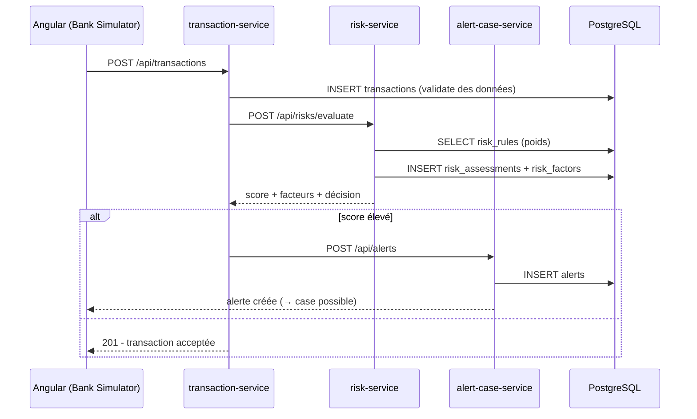

# Architecture des services — FinRisk360

> **Document M0** — référence unique pour le scaffolding des microservices.
> Il tranche : les dépôts, la propriété des tables, le plan de ports, les conventions de code et la feuille de route.

---

## 1. Décisions structurantes

| Sujet | Décision | Justification |
|---|---|---|
| Repository | **Monorepo** unique | un clone pour le jury, une CI, un commit pour un refactor transverse. L'isolement se joue au **déploiement** (conteneurs, ports), pas au nombre de dépôts |
| Base de données | **Un seul PostgreSQL partagé** par les services | souhaité par le cahier des charges (§15) : opérationnel, Data Warehouse, historisation |
| Isolation | **Règle de propriété** : un service n'écrit que dans *ses* tables, les autres passent par API | rend compatible « une base » et « des microservices » |
| Communication initiale | **REST/HTTP synchrone** | Kafka = extension documentée, pas en première version (§13) |
| Découverte des services | **Routes statiques**, pas de Eureka/Consul | 8 services = 8 lignes de YAML ; un serveur de découverte en plus serait de la complexité artificielle |
| ORM | Spring Data JPA, `spring.jpa.hibernate.ddl-auto: **validate**` | le schéma SQL (`postgres/02-schema.sql`) est la **source de vérité** ; Hibernate ne crée rien |
| Lombok | **Non utilisé** | évite les problèmes d'annotation processing, getters explicites et lisibles |

---

## 2. Les services et la propriété des tables

| # | Service | Port | Tables dont il est **seul responsable** |
|---|---|---|---|
| 1 | **api-gateway** | 8080 | *aucune* (route + authentifie, n'écrit jamais) |
| 2 | **customer-service** | 8081 | `customers` |
| 3 | **account-service** | 8082 | `accounts` |
| 4 | **transaction-service** | 8083 | `transactions`, `merchants` |
| 5 | **risk-service** | 8084 | `risk_assessments`, `risk_factors`, `risk_rules`, `risk_profiles` |
| 6 | **alert-case-service** | 8085 | `alerts`, `cases`, `case_comments`, `audit_logs` *(voir amendement M4)* |
| 7 | **ai-assistant-service** | 8086 | *aucune* (accès **lecture seule** aux API des autres) |
| 8 | **auth-service** | 8087 | `users`, `audit_logs` |

**Les 1-7 sont ceux du cahier des charges (§13)**. Le **auth-service** est un ajout assumé : `users` / `audit_logs` n'appartenaient à aucun service du document, et le RBAC (§18) exige un point d'entrée unique pour émettre et vérifier les JWT.

**Interdits** :
- un service ne crée pas de table qui n'est pas dans sa colonne ;
- un service ne fait pas de `JOIN` sur les tables d'un autre service ;
- un service ne lecture les autres que **par API** (AI Service compris).

**Amendement M3** : `risk_profiles` a été **transféré de `customer-service` à `risk-service`** — c'est la *baseline* d'entrée du moteur de risque (moyennes, P95, pays/horaire habituels), utilisée exclusivement par le Feature Engine ; `customer-service` ne détenait que l'entité, sans aucun usage.

**Amendement M4** : `audit_logs` est **écrit par `alert-case-service`** — le critère M4 (*« clôture tracée »*) exige la trace dès ce jalon, alors que `auth-service` n'existe pas qu'en M5. alert-case-service trace **ses** mutations (ALERT, CASE) avec `propagation = MANDATORY` (trace et mutation = même commit) ; depuis M5, `auth-service` ajoute les events `AUTH` (`LOGIN_SUCCESS/FAILED`, `USER_CREATED/UPDATED` — refus en `REQUIRES_NEW` pour survivre au rollback du 401), sans recouvrir les autres domaines — un seul écrivain par domaine reste la règle M0. Les identifiants des fixtures sont réservés aux tests. La base opérationnelle configure le compte administrateur au premier démarrage.

---

## 3. Plan des ports et des URLs

| Rôle | Port |
|---|---|
| API Gateway (entrée unique du front) | **8080** |
| customer-service → ai-assistant-service | **8081 → 8086** |
| auth-service | **8087** |
| Angular (développement) | **4200** |
| PostgreSQL | **5432** |
| Adminer (interface web de la base) | **5050** |
| Swagger de chaque service | `http://localhost:<port>/swagger-ui.html` |

En développement, le front appelle directement les services (facile à déboguer) ; le **Gateway** est branché à M5, comme mise en production de l'architecture.

---

## 4. Chaîne de valeur (flux métier)



Le **décideur humain** reste l'analyste : l'IA (§11) explique, elle ne décide pas.

---

## 5. Conventions de code

### Paquetage et nommage
- `tn.finrisk.<nomduobjet>danservice` → `tn.finrisk.customerservice`, `tn.finrisk.transactionservice`…
- Classes : `PascalCase` ; méthodes/variables : `camelCase` ; tables : `snake_case` ; SQL : `UPPER` pour les mots-clés
- Dossiers : `domain/` · `repository/` · `service/` · `web/` (+ `dto/`, `mapper/`, `error/`)

### REST
- Préfixe : `/api/…` → `/api/customers`, `/api/accounts`, `/api/transactions`, `/api/risks`, `/api/alerts`, `/api/cases`, `/api/auth`
- Ressource au **pluriel**, sans verbe : `GET /api/customers/{id}`, pas `GET /api/getCustomer`
- Codes : `200` OK · `201` créé · `204` sans contenu · `400` validation · `401` non authentifié · `403` rôle insuffisant · `404` introuvable · `409` conflit · `503` service amont absent
- **Pas de `DELETE` dur** sur les entités référencées : `PATCH /{id}/status` (désactivation)

### Format d'erreur unique

```json
{
  "timestamp": "2026-09-27T10:15:30Z",
  "status": 400,
  "message": "Validation échouée",
  "path": "/api/customers",
  "errors": [{ "field": "email", "message": "doit être une adresse valide" }]
}
```

### Types
| Sujet | Convention |
|---|---|
| Identifiant | `BIGSERIAL` en base → `Long` en Java |
| Dates | `OffsetDateTime` **UTC**, colonne `TIMESTAMPTZ` |
| Montants | `BigDecimal` ↔ `DECIMAL(19,4)` — **jamais** `double` |
| Pays / devise | `CHAR(2)` / `CHAR(3)` → `String` |
| Enum en base | `VARCHAR` + `CHECK` ↔ `enum` Java + `@Enumerated(STRING)` |
| Colonnes JSONB | `@JdbcTypeCode(SqlTypes.JSON)` |

### Sécurité (M5) ✅
Rôles (§18) : **`ADMIN`** (gestion des utilisateurs et configuration) · **`ANALYST`** (transactions, alertes, investigations, AI Assistant) · **`MANAGER`** (dashboards, rapports, statistiques). Le RBAC est **matriciel** (pas de hiérarchie) : chaque route du gateway porte ses propres `read-roles` / `write-roles`.
JWT signé au `auth-service` (HMAC-SHA256, `typ` access 15 min / refresh 7 j), validé au **Gateway** (401 sans/v faux token, 403 rôle insuffisant), revendiqué via `X-User-Id` / `X-User-Role` **injectés par le gateway** — les valeurs venues du client sont supprimées (anti-spoofing). Double garde : `auth-service` re-vérifie sur `/me` et `/api/users`. Détails : [auth-service.md](auth-service.md) · [api-gateway.md](api-gateway.md).

---

## 6. Qualité obligatoire

- `ddl-auto: validate` → le service **refuse de démarrer** si JPA et SQL divergent (test M1 n°5)
- Bean Validation sur **tous** les `@RequestBody`
- Tests : `@DataJpaTest` (repositories) · Mockito (logique métier) · `@WebMvcTest` (contrôleurs) · 1 test d'intégration sur base réelle (`finrisk_test`)
- **JUnit + Mockito obligatoire sur le Risk Service** : c'est le cœur testable du projet
- `Actuator` exposé sur chaque service (`/actuator/health`)
- Un commit = une fonctionnalité, message explicite en français

---

## 7. Structure du dépôt

```
projet services web/
├── .gitignore · README.md
├── backend/
│   ├── api-gateway/
│   ├── customer-service/          ← M1 (premier)
│   ├── account-service/
│   ├── transaction-service/
│   ├── risk-service/
│   ├── alert-case-service/
│   ├── ai-assistant-service/
│   └── auth-service/
├── frontend/                      ← Angular
├── etl/                           ← Data Warehouse
├── postgres/                      ← 01-init.sql · 02-schema.sql
├── docs/                          ← ce document, schéma, base-de-donnees.md
├── docker-compose.yml             ← postgres + adminer (+ services à M8)
└── scripts/                       ← sauvegardes, utilitaires
```

---

## 8. Feuille de route

| Jalon | Contenu | Critère de fin |
|---|---|---|
| **M0** ✅ | ce document | commité |
| **M1** ✅ | **customer-service** complet (CRUD, validation, Swagger, tests) | `GET /api/customers` renvoie des données de PostgreSQL — **voir [customer-service.md](customer-service.md)** |
| **M2** ✅ | **account-service** + **transaction-service** (REST **et** endpoint SOAP/XML) | transaction SOAP persistée en base — **voir [account-service.md](account-service.md) et [transaction-service.md](transaction-service.md)** |
| **M3** ✅ | **risk-service** : Feature Engine → Rule Engine → Scoring → Decision | transaction atypique → 87.00 HOLD + facteurs explicables — **voir [risk-service.md](risk-service.md)** |
| **M4** ✅ | **alert-case-service** + `audit_logs` | alerte → case → commentaire → clôture tracée (smoke : 17/17, trace 6+4 lignes) — **voir [alert-case-service.md](alert-case-service.md)** |
| **M5** ✅ | **auth-service** (JWT/RBAC) + **api-gateway** | 401 sans token, 403 si rôle insuffisant (smoke via gateway : 27/27, dont 403 matrice + propagation `X-User-Id` vérifiée en base) — **voir [auth-service.md](auth-service.md) et [api-gateway.md](api-gateway.md)** |
| **M6** ✅ | **ai-assistant-service** (LLM, lecture seule) | analyse + chat déterministes (42 tests), route `/api/ai/**` dans la matrice RBAC du gateway (25 tests) |
| **M7** | **Angular** : Bank Simulator, Dashboard, Alerts, Cases, IA | bouton *Send Transaction* → chaîne complète |
| **M8** | Docker Compose complet + GitHub Actions + ETL/Power BI | `docker compose up` = démo entière |

---

## 9. Extensions citées (hors périmètre initial)

Kafka (bus événementiel) · Eureka (découverte) · rate limiting Redis · circuit breaker Resilience4j · split en multi-dépôt · tests E2E Playwright.

*À mentionner en soutenance comme choix conscients de ne pas les intégrer au premier jet.*
