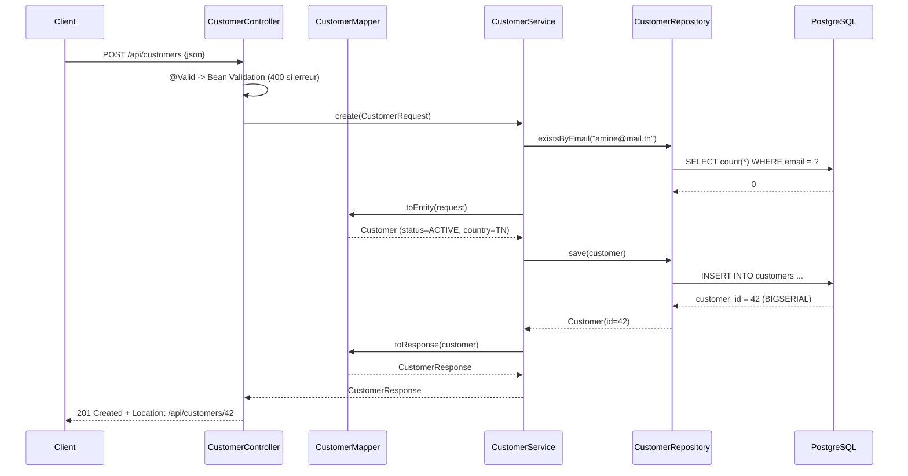

# `customer-service` — Guide complet

> **Microservice 2/8 de FinRisk360** · port **8081** · propriétaire des tables **`customers`**, **`accounts`**, **`risk_profiles`** · jalon **M1** ✅
>
> Ce document explique **tout** : ce que le service fait, comment il est construit, chaque fichier, chaque endpoint, chaque test, et comment le dépanner.

---

## Sommaire

1. [À quoi sert ce service](#1-à-quoi-sert-ce-service)
2. [Démarrage rapide](#2-démarrage-rapide)
3. [Arborescence commentée](#3-arborescence-commentée)
4. [L'architecture en 4 couches](#4-larchitecture-en-4-couches)
5. [Les entités et leur correspondance SQL](#5-les-entités-et-leur-correspondance-sql)
6. [Les 6 endpoints, en détail](#6-les-6-endpoints-en-détail)
7. [Les règles métier et les erreurs](#7-les-règles-métier-et-les-erreurs)
8. [Le format d'erreur unique](#8-le-format-derreur-unique)
9. [La configuration](#9-la-configuration)
10. [Swagger](#10-swagger)
11. [Les tests](#11-les-tests)
12. [Les bases de données utilisées](#12-les-bases-de-données-utilisées)
13. [Dépannage](#13-dépannage)
14. [Historique du développement (M1)](#14-historique-du-développement-m1)
15. [Ce qui reste à faire (M2+)](#15-ce-qui-reste-à-faire-m2)
16. [Points de soutenance](#16-points-de-soutenance)

---

## 1. À quoi sert ce service

Il **gère le référentiel client** de la banque :

| Il fait | Il ne fait pas |
|---|---|
| Créer / consulter / modifier un client | ❌ créer des comptes (M2) |
| Lister les comptes d'un client (lecture) | ❌ évaluer le risque (Risk Service) |
| Changer le statut d'un client (suspendre, clore) | ❌ gérer les utilisateurs/analystes (auth-service) |
| Maintenir le profil de risque du client (table mappée) | ❌ supprimer définitivement un client |

**Ownership** (règle M0) : ce service est le **seul** à pouvoir écrire dans `customers`, `accounts`, `risk_profiles`. Un autre service qui aurait besoin d'un client passera **par son API**.

**Dépendances externes** : uniquement PostgreSQL. Aucun appel sortant vers un autre microservice.

---

## 2. Démarrage rapide

```powershell
# 0. infra (une fois par session)
docker compose up -d                       # postgres (5432) + adminer (5050)

# 1. lancer le service
cd backend\customer-service
mvn spring-boot:run                        # ou : mvn -q -DskipTests package puis java -jar target\customer-service-0.0.1-SNAPSHOT.jar

# 2. vérifier
curl.exe -s --noproxy "*" http://127.0.0.1:8081/actuator/health
# {"status":"UP", "components":{"db":{"database":"PostgreSQL","status":"UP"}}}

# 3. tester
#    - Swagger      : http://localhost:8081/swagger-ui.html
#    - Base de données : http://localhost:5050  (serveur=postgres, base=finrisk, user=finrisk, mdp=<POSTGRES_PASSWORD>)

# 4. les tests
mvn test                                   # 15 tests

# 5. arrêter
#    fermer le process java, ou sous Windows :
Get-Process java | Where-Object { $_.Path -notlike "*\.vscode\*" } | Stop-Process
```

| URL | Rôle |
|---|---|
| `http://localhost:8081/actuator/health` | santé du service + de la base |
| `http://localhost:8081/swagger-ui.html` | documentation interactive |
| `http://localhost:8081/v3/api-docs` | spécification OpenAPI 3.1 (JSON) |
| `http://localhost:5050` | Adminer → navigateur sur la base |

---

## 3. Arborescence commentée

```
backend/customer-service/
├── pom.xml                              ← dépendances (Boot 4.1.1, 6 starters)
├── mvnw, mvnw.cmd, .mvn/                ← wrapper Maven (inutilisé : Maven 3.9 global)
├── HELP.md, .gitattributes, .gitignore  ← fichiers générés par Initializr
│
├── src/main/java/tn/finrisk/customerservice/
│   ├── CustomerServiceApplication.java  ← point d'entrée : @SpringBootApplication
│   │
│   ├── domain/                          ← COUCHE 1 : la base de données
│   │   ├── Customer.java                ← table customers        (13 colonnes)
│   │   ├── Account.java                 ← table accounts         ( 9 colonnes, FK client)
│   │   ├── RiskProfile.java             ← table risk_profiles    (17 colonnes, 1:1 client)
│   │   └── enums/
│   │       ├── CustomerType.java        ← RETAIL | PREMIUM | SME | CORPORATE
│   │       ├── CustomerStatus.java      ← ACTIVE | SUSPENDED | CLOSED
│   │       ├── AccountType.java         ← CHECKING | SAVINGS | CARD
│   │       ├── AccountStatus.java       ← ACTIVE | FROZEN | CLOSED
│   │       └── RiskLevel.java           ← LOW | MEDIUM | HIGH | CRITICAL
│   │
│   ├── repository/                      ← COUCHE 2 : les requêtes SQL
│   │   ├── CustomerRepository.java      ← findByEmail, existsByEmail
│   │   ├── AccountRepository.java       ← findByCustomerCustomerId..., Page...
│   │   └── RiskProfileRepository.java   ← findByCustomerCustomerId (1:1)
│   │
│   ├── service/                         ← COUCHE 3 : la logique métier
│   │   ├── CustomerService.java         ← 6 méthodes + 1 règle (email unique)
│   │   └── AccountService.java          ← comptes d'un client (lecture)
│   │
│   └── web/                             ← COUCHE 4 : le protocole HTTP
│       ├── CustomerController.java      ← 6 endpoints, zéro logique métier
│       ├── dto/
│       │   ├── CustomerRequest.java     ← record : ce qui ENTRRE (8 champs validés)
│       │   ├── CustomerResponse.java    ← record : ce qui SORT   (11 champs choisis)
│       │   └── AccountResponse.java     ← record : un compte vu par l'API
│       ├── mapper/
│       │   ├── CustomerMapper.java      ← @Component : entité ⇄ DTO
│       │   └── AccountMapper.java       ← @Component : entité ⇄ DTO
│       └── error/
│           ├── CustomerNotFoundException.java    ← métier → 404
│           ├── EmailAlreadyExistsException.java  ← métier → 409
│           ├── ErrorResponse.java                ← {timestamp,status,message,path,errors[]}
│           └── GlobalExceptionHandler.java       ← 8 @ExceptionHandler
│
├── src/main/resources/
│   └── application.yml                  ← port 8081, datasource, ddl-auto: validate
│
└── src/test/                            ← 15 tests, 3 niveaux
    ├── resources/application-test.yml   ← base finrisk_test
    └── java/tn/finrisk/customerservice/
        ├── CustomerServiceApplicationTests.java       ← contexte (1)
        ├── CustomerServiceIntegrationTest.java        ← PostgreSQL réel (2)
        ├── service/CustomerServiceTest.java           ← unitaire Mockito (5)
        └── web/CustomerControllerTest.java            ← MockMvc (7)
```

**24 fichiers Java** au total (14 de production, 5 de configuration/infra, 4 de tests + 1 main).

---

## 4. L'architecture en 4 couches

```
        Client (Swagger, curl, futur Angular)
                     │
                     ▼
   ┌─────────────────────────────────────────┐
   │  web/CustomerController                 │  Route, parse, valide, formate
   │  @RestController  @RequestMapping       │  → HTTP : 200/201/400/404/409
   └─────────────────────────────────────────┘
                     │ CustomerRequest / ids
                     ▼
   ┌─────────────────────────────────────────┐
   │  web/mapper + web/dto                   │  Le filtre d'entrée/sortie
   │  CustomerMapper : JSON ⇄ entité         │  → contrôle ce qui transite
   └─────────────────────────────────────────┘
                     │
                     ▼
   ┌─────────────────────────────────────────┐
   │  service/CustomerService  @Service      │  LES RÈGLES
   │  - email unique ?  - existe ?  - défaut │  → lève des exceptions métier
   │  @Transactional(readOnly=true / true)   │     (jamais de HTTP)
   └─────────────────────────────────────────┘
                     │ entité Customer
                     ▼
   ┌─────────────────────────────────────────┐
   │  repository/CustomerRepository          │  Le SQL
   │  extends JpaRepository<T,ID>           │  → généré par Spring Data
   └─────────────────────────────────────────┘
                     │ SQL via HikariCP
                     ▼
              PostgreSQL (5432)  —  tables customers / accounts / risk_profiles
```

### Flux complet d'un `POST /api/customers`



### La règle d'or de cette architecture

> **Chaque couche ne parle qu'à sa voisine directe.**
> Le contrôleur ne sait pas que PostgreSQL existe ; le repository ne sait pas ce qu'est une requête HTTP ; le service ne connaît ni JSON ni status HTTP.

Conséquence pratique : on peut **remplacer une couche sans toucher aux autres** (ex. : le jour où les données viendront d'un autre service, seul le repository change).

---

## 5. Les entités et leur correspondance SQL

### `Customer` ↔ `customers`

| Colonne SQL | Attribut Java | Annotation clé |
|---|---|---|
| `customer_id BIGSERIAL PK` | `Long customerId` | `@Id @GeneratedValue(IDENTITY)` |
| `first_name VARCHAR(50) NOT NULL` | `String firstName` | `@Column(nullable=false, length=50)` |
| `last_name VARCHAR(50) NOT NULL` | `String lastName` | idem |
| `email VARCHAR(100) UNIQUE` | `String email` | `@Column(length=100, unique=true)` |
| `phone VARCHAR(20)` | `String phone` | `@Column(length=20)` |
| `date_of_birth DATE` | `LocalDate dateOfBirth` | type natif `LocalDate` |
| `country CHAR(2)` | `String country` | `@JdbcTypeCode(SqlTypes.CHAR)` + `length=2` |
| `city VARCHAR(50)` | `String city` | `@Column(length=50)` |
| `customer_type VARCHAR(20) DEFAULT 'RETAIL'` | `CustomerType customerType` | `@Enumerated(STRING)` + valeur initiale `RETAIL` |
| `registration_date TIMESTAMPTZ DEFAULT now()` | `OffsetDateTime registrationDate` | `@PrePersist` → `now(UTC)` |
| `status VARCHAR(20) DEFAULT 'ACTIVE'` | `CustomerStatus status` | `@Enumerated(STRING)` + init `ACTIVE` |

> `customer_type` et `status` portent en SQL un `CHECK (...)`. Hibernate **ne valide pas** les CHECK : c'est l'`enum` Java qui empêche la valeur interdite côté application, et le CHECK qui l'empêche côté base (double barrière).

### `Account` ↔ `accounts`

| Colonne SQL | Attribut Java | Note |
|---|---|---|
| `account_id BIGSERIAL PK` | `Long accountId` | |
| `customer_id BIGINT FK NOT NULL` | `Customer customer` | **`@ManyToOne(LAZY)` + `@JoinColumn`** |
| `account_number VARCHAR(20) UNIQUE` | `String accountNumber` | |
| `account_type DEFAULT 'CHECKING'` | `AccountType` | enum |
| `currency CHAR(3) DEFAULT 'TND'` | `String currency` | `@JdbcTypeCode(SqlTypes.CHAR)` |
| `balance DECIMAL(15,2) DEFAULT 0` | `BigDecimal balance` | **jamais `double`** |
| `opening_date DATE DEFAULT CURRENT_DATE` | `LocalDate` | `@PrePersist` |
| `status DEFAULT 'ACTIVE'` | `AccountStatus` | enum |

### `RiskProfile` ↔ `risk_profiles` (1:1 avec le client)

Points particuliers :

| Colonne | Choix Java | Pourquoi |
|---|---|---|
| `customer_id UNIQUE` | `@OneToOne @JoinColumn(unique=true)` | 1 profil par client |
| `feature_snapshot JSONB` | `@JdbcTypeCode(SqlTypes.JSON)` sur un `String` | Hibernate lie le JSON sans librairie externe |
| `usual_transaction_hour SMALLINT` | `@JdbcTypeCode(SqlTypes.SMALLINT)` | sinon Hibernate attend `integer` → **erreur `validate`** |
| `avg/p95/p99... DECIMAL(15,2)` | `BigDecimal precision=15 scale=2` | précision financière |
| `stats_window_days NOT NULL DEFAULT 90` | init `90` + `@PrePersist` | |

### Les annotations, en résumé

| Annotation | Signification |
|---|---|
| `@Entity` | cette classe est persistante |
| `@Table(name=...)` | table cible |
| `@Id` | clé primaire |
| `@GeneratedValue(IDENTITY)` | valeur générée par la base (BIGSERIAL) |
| `@Column(name, nullable, length, unique, precision, scale)` | colonne + contraintes |
| `@Enumerated(STRING)` | enum stocké sous forme de texte |
| `@ManyToOne / @OneToOne / @JoinColumn` | clé étrangère → objet référencé |
| `@JdbcTypeCode(SqlTypes.X)` | force le **type JDBC** attendu (CHAR, SMALLINT, JSON) |
| `@PrePersist` | callback avant INSERT (équivalent des `DEFAULT`) |
| `@Transactional` | délimite une transaction (au niveau service, pas entité) |

---

## 6. Les 6 endpoints, en détail

| # | Méthode | URL | Corps | Succès | Erreurs possibles |
|---|---|---|---|---|---|
| 1 | **GET** | `/api/customers?page&size&sort` | — | **200** page JSON | 400 |
| 2 | **GET** | `/api/customers/{id}` | — | **200** client | 400, **404** |
| 3 | **GET** | `/api/customers/{id}/accounts` | — | **200** tableau | 400, **404** |
| 4 | **POST** | `/api/customers` | `CustomerRequest` | **201** + `Location` | **400**, **409** |
| 5 | **PUT** | `/api/customers/{id}` | `CustomerRequest` | **200** | 400, 404, 409 |
| 6 | **PATCH** | `/api/customers/{id}/status?status=X` | — | **200** | 400, 404 |

### 6.1 `GET /api/customers` — liste paginée

Paramètres : `page` (défaut 0), `size` (défaut 20, **borné 1..100**), `sort` (défaut `customerId`).

```json
{
  "content": [{ "customerId": 1, "firstName": "Amine", ... }],
  "totalElements": 1, "totalPages": 1,
  "number": 0, "size": 20
}
```

### 6.2 `GET /api/customers/{id}`

```json
{
  "customerId": 1,
  "firstName": "Amine", "lastName": "Ben Ali",
  "email": "amine@mail.tn", "phone": "+216 71 234 567",
  "dateOfBirth": "1995-04-12",
  "country": "TN", "city": "Tunis",
  "customerType": "RETAIL", "status": "ACTIVE",
  "registrationDate": "2026-10-02T14:36:18.389Z"
}
```
`404` si inconnu.

### 6.3 `GET /api/customers/{id}/accounts`

```json
[ { "accountId": 3, "accountNumber": "TN12...", "accountType": "CHECKING",
    "currency": "TND", "balance": 1250.50,
    "openingDate": "2026-01-15", "status": "ACTIVE" } ]
```
`[]` si aucun compte · `404` si le client n'existe pas (vérifié **avant** la requête comptes).

### 6.4 `POST /api/customers` — création

**Requête**
```json
{
  "firstName": "Amine",
  "lastName": "Ben Ali",
  "email": "amine@mail.tn",
  "phone": "+216 71 234 567",
  "dateOfBirth": "1995-04-12",
  "country": "tn",
  "city": "Tunis",
  "customerType": "RETAIL"
}
```

**Réponse `201 Created`** + en-tête `Location: /api/customers/1`
```json
{ "customerId": 1, ..., "country": "TN", "customerType": "RETAIL",
  "status": "ACTIVE", "registrationDate": "2026-10-02T14:36:18Z" }
```
Note : `"tn"` → `"TN"` (normalisé par le mapper) ; `status` et `registrationDate` **fournis par le serveur**.

### 6.5 `PUT /api/customers/{id}` — remplacement

Même corps que la création. Seuls les champs fournis sont modifiables ; `customerId` et `registrationDate` sont ignorés s'ils sont envoyés (absents du record). Contrôle d'email **unique en excluant le client lui-même**.

### 6.6 `PATCH /api/customers/{id}/status` — changement de statut

```
PATCH /api/customers/1/status?status=SUSPENDED   →  200 {"status":"SUSPENDED"}
PATCH /api/customers/1/status?status=FOO         →  400 {"message":"Parametre 'status' invalide : FOO"}
```
Valeurs : `ACTIVE`, `SUSPENDED`, `CLOSED`. **Il n'y a pas de `DELETE`** : un client ayant des comptes/transactions est protégé par `ON DELETE RESTRICT` — on désactive, on ne supprime pas.

### Test en 30 secondes (Swagger)

1. Ouvrir `http://localhost:8081/swagger-ui.html`
2. **Customers → POST /api/customers → Try it out** → coller le payload ci-dessus → **Execute**
3. Réessayer avec le **même email** → `409`

---

## 7. Les règles métier et les erreurs

| # | Règle | Où elle est implémentée | Si elle est violée |
|---|---|---|---|
| R1 | **Un email ne peut être porté que par un seul client** | `CustomerService.assertEmailIsFree()` (appelé en création **et** en modification) | `EmailAlreadyExistsException` → **409** |
| R2 | **Un client demandé doit exister** | `CustomerService.getById/update/changeStatus` + `AccountService.getAccountsOf` | `CustomerNotFoundException` → **404** |
| R3 | **Pas de suppression dure** | aucun `delete()` exposé ; seul `changeStatus` existe | `ON DELETE RESTRICT` en base |
| R4 | **Valeurs par défaut** : type `RETAIL`, statut `ACTIVE`, date = maintenant | init des champs + `@PrePersist` + `CustomerMapper` | — |
| R5 | **Validation des entrées** (prénom requis, email valide, naissance passée, pays = 2 lettres) | `CustomerRequest` (`@NotBlank`, `@Email`, `@Past`, `@Size`) + `@Valid` | `MethodArgumentNotValidException` → **400** + `errors[]` |
| R6 | **Le pays est normalisé en majuscules** | `CustomerMapper.toEntity` (`toUpperCase`) | — |
| R7 | **La base reste la source de vérité** | `ddl-auto: validate` | démarrage **refusé** si écart Java/SQL |

**Deux barrières pour l'email** (à citer en soutenance) :
1. contrôle **propre** avant écriture → message lisible, code sémantique 409 ;
2. contrainte `UNIQUE` en base → si deux requêtes simultanées passent entre les deux, PostgreSQL lève `DataIntegrityViolationException`, que `GlobalExceptionHandler` re-transforme **aussi** en 409 (jamais de 500).

---

## 8. Le format d'erreur unique

Défini par `docs/architecture-services.md`, produit **exclusivement** par `GlobalExceptionHandler` :

```json
{
  "timestamp": "2026-10-02T14:40:02.486Z",
  "status": 409,
  "message": "Un client possede deja cet email : amine@mail.tn",
  "path": "/api/customers",
  "errors": []
}
```

| Exception interceptée | HTTP | Champ `errors` |
|---|---|---|
| `CustomerNotFoundException` | 404 | vide |
| `EmailAlreadyExistsException` | 409 | vide |
| `DataIntegrityViolationException` (course) | 409 | vide (détail loggé côté serveur) |
| `MethodArgumentNotValidException` | 400 | **rempli** : `[{field, message}]` |
| `MethodArgumentTypeMismatchException` (`/abc`, `?status=FOO`) | 400 | vide |
| `HttpMessageNotReadableException` (JSON cassé) | 400 | vide |
| `MissingServletRequestParameterException` | 400 | vide |
| `Exception` (tout le reste) | 500 | vide + stacktrace **dans les logs serveur seulement** |

Exemple réel de 400 avec détail :
```json
{"timestamp":"2026-10-02T14:40:02.644Z","status":400,"message":"Validation echouee",
 "path":"/api/customers",
 "errors":[{"field":"firstName","message":"le prenom est obligatoire"},
           {"field":"email","message":"l'email doit etre une adresse valide"}]}
```

---

## 9. La configuration

Voir le guide dédié : **[`docs/configuration-service.md`](configuration-service.md)**.

Résumé des points critiques :

```yaml
server.port: 8081                                  # plan de ports M0
spring.datasource.url: jdbc:postgresql://localhost:5432/finrisk
spring.datasource.password: ${POSTGRES_PASSWORD}
spring.jpa.hibernate.ddl-auto: validate            # JAMAIS "update"
spring.jpa.open-in-view: false
management.endpoints.web.exposure.include: health,info
logging.level.org.hibernate.SQL: DEBUG             # SQL affiché en dev
```

**Profil de test** (`src/test/resources/application-test.yml`, activé par `@ActiveProfiles("test")`) : même configuration mais base **`finrisk_test`**, log SQL en `WARN`.

---

## 10. Swagger

- **UI** : `http://localhost:8081/swagger-ui.html`
- **JSON** : `http://localhost:8081/v3/api-docs` (OpenAPI 3.1)

Annotations utilisées dans `CustomerController` :

| Annotation | Effet affiché |
|---|---|
| `@Tag(name="Customers", description=...)` | nom du groupe dans l'UI |
| `@Operation(summary=..., description=...)` | titre + explication de l'endpoint |
| `@ApiResponses({@ApiResponse(code, description)})` | liste des codes de retour |
| `@Parameter(description=...)` | aide sur chaque paramètre |

Vérification :
```powershell
(curl.exe -s --noproxy "*" http://127.0.0.1:8081/v3/api-docs | ConvertFrom-Json).tags.name
# Customers
```

**Valeur ajoutée** : le front Angular pourra générer son client HTTP à partir de ce fichier ; le jury dispose d'une doc **toujours à jour** puisqu'elle est dérivée du code.

---

## 11. Les tests

```powershell
mvn test
# Tests run: 15, Failures: 0, Errors: 0, Skipped: 0  →  BUILD SUCCESS
```

| Classe | N° | Type | Méthode | Ce qu'elle vérifie |
|---|---|---|---|---|
| `CustomerServiceTest` | 1 | unitaire | `create_emailDejaUtilise_...` | lève `EmailAlreadyExistsException` **et n'appelle jamais `save()`** |
| | 2 | unitaire | `create_donneesValides_...` | défauts `RETAIL`/`ACTIVE`, pays passé en `TN`, id=42 renvoyé |
| | 3 | unitaire | `getById_identifiantInconnu_...` | lève `CustomerNotFoundException` |
| | 4 | unitaire | `getById_identifiantExistant_...` | DTO correctement rempli |
| | 5 | unitaire | `changeStatus_sansParametre_...` | `ACTIVE` → `SUSPENDED` |
| `CustomerControllerTest` | 6 | `@WebMvcTest` | `getCustomer_existant_retourne200` | 200 + JSON |
| | 7 | | `getCustomer_inexistant_retourne404...` | 404 + `status`/`message`/`path` |
| | 8 | | `create_donneesInvalides_...` | 400 + `errors[0].field = firstName` |
| | 9 | | `create_donneesValides_...` | 201 + header `Location` |
| | 10 | | `create_emailDejaUtilise_retourne409` | 409 |
| | 11 | | `listerClients_retourneLaPage` | `content[0]`, `totalElements` |
| | 12 | | `getCustomer_identifiantNonNumerique_...` | `/abc` → 400 |
| `CustomerServiceIntegrationTest` | 13 | intégration | `creation_relecture_et_doublon_dans_postgres` | INSERT + SELECT + doublon réels dans `finrisk_test`, **ROLLBACK** |
| | 14 | | `compteDesClients_estStrictementPositif` | accès au `count()` réel |
| `CustomerServiceApplicationTests` | 15 | contexte | `contextLoads` | tous les beans + Hibernate `validate` se chargent |

**Pourquoi 3 niveaux** :

| Niveau | Base ? | HTTP ? | Durée | Sert à détecter |
|---|---|---|---|---|
| unitaire (Mockito) | ❌ | ❌ | 0,35 s | une **décision** fausse (règle métier) |
| `@WebMvcTest` | ❌ | simulé | 1,2 s | une **route/corps/réponse** faux |
| intégration | ✅ `finrisk_test` | ❌ | 5 s | un **SQL ou un mapping** faux |

Les tests d'intégration sont `@Transactional` : la transaction est **annulée** à la fin → `finrisk_test` reste propre.

---

## 12. Les bases de données utilisées

| Base | Usage | Créée par |
|---|---|---|
| **`finrisk`** | base **opérationnelle** du service (dev, données réelles) | `docker-compose.yml` → `postgres/01-init.sql` + `02-schema.sql` |
| **`finrisk_test`** | base des **tests d'intégration**, isolée | `01-init.sql` clone le schéma complet avant la rotation des comptes |

Rôles :
- `postgres` / `POSTGRES_ADMIN_PASSWORD` → superutilisateur (Adminer, migrations)
- `finrisk` / `<POSTGRES_PASSWORD>` → rôle applicatif (le service ne connaît **que** celui-ci)

Consulter les données :
- **Adminer** : `http://localhost:5050` → serveur `postgres`, base `finrisk`, utilisateur `finrisk`
- **ligne de commande** :
```powershell
docker exec finrisk-postgres psql -U finrisk -d finrisk -c "SELECT customer_id, first_name, email, status FROM customers;"
```

Recréer tout depuis zéro (en perdant les données) :
```powershell
docker compose down -v          # supprime le volume
docker compose up -d            # 01-init.sql puis 02-schema.sql rejoués (bases + seed)
```

---

## 13. Dépannage

| Symptôme | Cause | Correction |
|---|---|---|
| `Port 8081 was already in use` | un ancien `java -jar` tourne | tuer le process (attention : ne pas tuer le `java` de VS Code — `Get-CimInstance Win32_Process -Filter "Name='java.exe'"` pour identifier) |
| `Connection to localhost:5432 refused` | Docker/conteneur arrêté | `docker compose up -d` |
| `Schema validation: missing table [x]` | base vide (ex. `finrisk_test` fraîche) | appliquer `02-schema.sql` à cette base |
| `Schema validation: wrong column type ... found [bpchar], expecting [char(3)]` | `@Column` n'a pas forcé le type | `@JdbcTypeCode(SqlTypes.CHAR)` |
| `Wrong column type ... expected integer but found smallint` | idem pour `SMALLINT` | `@JdbcTypeCode(SqlTypes.SMALLINT)` |
| `Unable to rename ... .jar` pendant `mvn package` | le JAR est en cours d'exécution | arrêter le service avant de builder |
| `Unable to access jarfile C:\...\projet` | chemin avec espace non protégé | guillemets autour du chemin |
| `No enum constant ...SerializationFeature.write-dates-as-timestamps` | option Jackson 2 dans Boot 4 (Jackson 3) | supprimer ce bloc du `application.yml` |
| `package ...web.servlet does not exist` (`@WebMvcTest`) | Boot 4 a changé de paquetage | `org.springframework.boot.webmvc.test.autoconfigure.WebMvcTest` |
| Réponse **500** alors qu'on attend 404/409 | exception métier non interceptée | vérifier que `GlobalExceptionHandler` est bien dans le paquetage scanné |
| Test qui échoue sur `missing table` | schéma absent de `finrisk_test` | voir ci-dessus |

---

## 14. Historique du développement (M1)

Chaque étape = un commit, testée avant de passer à la suivante.

| Étape | Contenu | Commit | Résultat |
|---|---|---|---|
| 1 | Squelette Spring Initializr + fix version `4.1.1` | (sur `main`) | `mvn compile` OK |
| 2 | `application.yml` (port, datasource, validate) | `31e1967`* | service démarré, `db: UP` |
| 3 | 3 entités + 5 enums | `be4a79a` | **`validate` a bloqué sur `currency`** puis est passé |
| 4 | 3 repositories | `db6a399` | `Found 3 JPA repository interfaces` |
| 5 | DTO Request/Response + Mapper | `56a7875` | compile |
| 6 | `CustomerService` + 2 exceptions métier | `da9e7e3` | compile |
| 7 | `CustomerController` (6 endpoints) + `AccountService` | `c323e76` | 6 tests manuels OK, **3 défauts 500 détectés** |
| 8 | `GlobalExceptionHandler` + `ErrorResponse` | `1f91e90` | **8 tests d'erreur : 404/409/400 propres** |
| 9 | Swagger + 15 tests + base `finrisk_test` | `f9eb98b` | **`mvn test` : 15/15** |
| 10 | Documentation + finalisation | (ce commit) | M1 bouclé |

\* `31e1967` porte aussi la doc de configuration.

**Erreurs réellement rencontrées et corrigées** (matière première pour le rapport) :
1. version parent introuvable sur Maven Central (`4.1.1.RELEASE` → `4.1.1`)
2. propriété Jackson 2 inexistante sous Boot 4
3. `import EnumType` manquant
4. `validate` : `CHAR` vs `VARCHAR` sur `currency` → `@JdbcTypeCode`
5. chemin avec espace non guillemeté au lancement
6. `finrisk_test` sans schéma → tests d'intégration en échec
7. `@WebMvcTest` déplacé dans Boot 4

---

## 15. Ce qui reste à faire (M2+)

| Jalon | Sur ce service |
|---|---|
| **M2** | `POST /api/accounts` (création de compte), éventuellement `GET /api/customers/{id}/risk-profile` exposé |
| **M3+** | le Risk Service appellera `GET /api/customers/{id}` en interne |
| **M5** | `auth-service` (JWT) + `api-gateway` : `/api/customers` sera appelé **via le Gateway** (8080) et non plus directement |
| **M7** | Angular : écran « Clients » (liste paginée, formulaire de création, détail avec comptes) |
| **M8** | conteneurisation : `Dockerfile` multi-stage (`maven:3.9-eclipse-temurin-21` → `eclipse-temurin:21-jre`), port 8081 exposé dans le `docker-compose.yml` |

Extensions citées dans `architecture-services.md` : tests E2E (Playwright), CI GitHub Actions sur `mvn test`, couverture de code (JaCoCo).

---

## 16. Points de soutenance

1. **Pourquoi un monorepo ?** un clone, une CI, un refactor en un commit ; l'isolement se fait par **conteneur/port**, pas par dépôt.
2. **Pourquoi `ddl-auto: validate` et pas `update` ?** le SQL (`02-schema.sql`) est la source de vérité ; `update` modifierait le schéma silencieusement et divergerait avec le Data Warehouse.
3. **Pourquoi ne jamais renvoyer une entité ?** fuite de données, couplage base↔API, `LazyInitializationException`, cycles JSON → d'où les **DTO + Mapper**.
4. **Pourquoi une exception métier plutôt qu'un `500` ?** séparation des couches : le service ne connaît pas HTTP ; un seul `GlobalExceptionHandler` traduit (404/409/400).
5. **Deux barrières sur l'email** : contrôle applicatif + `UNIQUE` en base.
6. **3 niveaux de tests** : la logique métier est testée **sans** base, le SQL **avec** une base isolée en rollback.
7. **Property en `${VAR:défaut}`** : le secret n'est pas dans le git.
8. **`@JdbcTypeCode`** : preuve qu'on a réellement confronté notre Java au schéma réel (erreur `bpchar` rencontrée et corrigée).
